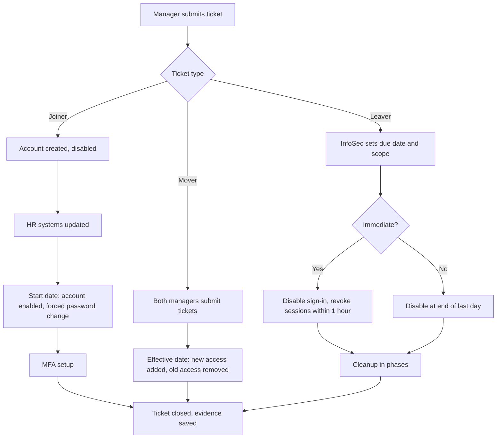

# Joiner, Mover, Leaver Process (Fictional Company)

This is a practice project using a made-up company. It does not describe any real organization.

## The company

Pluto and Clifford Vet Services. A veterinarian office that treats household and farm animals. The company has 100 employees.

## Roles and access

HR - Email, HR systems
IT - Email, IT systems
Vets - Email, practice management system

## Identity system

They operate using Microsoft services such as Microsoft Entra and M365. They identify using MFA. A user enters their username and password plus a second factor, ideally an authenticator app, since SMS codes are weaker. They must enter the correct code to finish logging in.

## Process overview

## Joiner process

Managers will submit a ticket filling out a Joiner template with the employee's info. Upon hire a joiner will have their start date 2 weeks from when they've accepted the job offer. In those 2 weeks the employee account will be created giving access to email, their respective resources based on their role, and they will be added to the list of people that will need to setup MFA on their start date. If the employee is a re-hire then access needs to be re-approved, not automatically restored.

In that 2 week window HR systems will also be updated with employee information and job role. The 2 week hold will provide sufficient time to setup the employee account properly. If more information is needed from the hiring manager the team will reach out to them.

The account is created early but it will be kept disabled until the start date (or a few days before), and force a password change at first login. On the employee's first day, they will be asked to setup MFA after successfully logging into their email for the first time with a temporary password. Once MFA is setup they should have access to their respective resources.

## Mover process

The mover process will be similar to joiner. When the employee has accepted the move then the managers will submit tickets. The current manager will address the leave, the effective date, and what access should or should not be removed. The new manager will address the new move/hire date for the department and will mention needed access. When the employee is moved to another department their start date will be 2 weeks from the day they accepted the move. New access is added on the effective start date, and old access is removed on the effective date unless a short handover period is approved. HR systems will be updated to reflect the new job role and other information if needed.

## Leaver process

Managers will submit a ticket filling out a Leaver template with the employee’s info. The InfoSec team will view the ticket, add a due date as to when the ticket should be started on and up to how much access should be removed by said date. Immediate terminations disable sign-in and revoke sessions right away; planned departures are disabled at the end of the last day. After sign-in is disabled, the remaining access is removed in stages, and the account is deleted after a retention period. Some of the leaver’s files or mailbox may be kept for their manager. Managers will be contacted if more information is needed and when the ticket has finally been resolved.

## Controls and evidence

- Policies must address how and when managers should submit tickets.
- InfoSec should have an SLA for onboarding and offboarding. An immediate termination can be started before HR updates the record, with HR confirmation to follow. Immediate termination will be done within 1 hour of the ticket and planned leavers will be disabled end of day. Joiners should be ready 3 days before their start date.
- Everything will be tracked through a ticketing system. Where notes, updates,completion checklist of related task, and communications of any kind can be saved.
- Quarterly access reviews will be done to make sure all employees have just enough access for their job role and not more. As well as keeping track of current and past employees status and access.

## Risks

- A joiner could immediately resign and/or if they are a risk then permissions need to be removed immediately. If managers are not making a note that the matter is urgent then it could be missed.

- If managers overuse the "urgent" status of the ticket then the team could suffer fatigue and possibly miss an actual urgent ticket.

- If tickets are not properly filled out or not submitted according to the agreed upon SLA then the ticket could be missed or take longer to do at any stage of the joiner/mover/leaver process.

- Managers must also keep track of their tickets if they still need to be addressed or if say an employee changed their mind. If so, the ticket should be closed.
